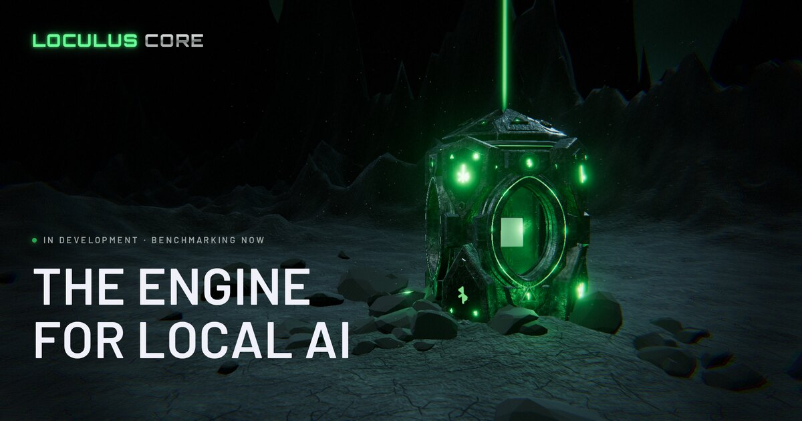

  

<h2 align="center"><a href="https://loculuscore.com">loculuscore.com</a></h2>

  <a href="https://loculuscore.com"><b>Website</b></a> ·
  <a href="https://loculuscore.com/performance"><b>Performance</b></a> ·
  <a href="https://loculuscore.com/compatibility"><b>Compatibility</b></a> ·
  <a href="https://www.youtube.com/@loculuscoreengine"><b>YouTube</b></a> ·
  <a href="https://loculuscore.com/register"><b>Register your interest</b></a>

# Loculus Core

**Run large AI models locally, faster.** Loculus Core is a local inference engine built from first principles. It runs
large open models like DeepSeek, Qwen, Llama and gpt-oss on your own GPU, and makes pictures on the same engine.

**Now in benchmarking.** Loculus Core is in benchmarking and compatibility testing across model families and GPUs. The
first release is for Linux, then Windows, Android, macOS and iOS. When it's released, you'll get it from
[loculuscore.com](https://loculuscore.com), where you'll also find how it works and how fast it runs.

**About this repository.** This is Loculus Core's public home on GitHub, with links to everything about it. Loculus
Core itself isn't open source.

Follow the progress on [YouTube](https://www.youtube.com/@loculuscoreengine).
